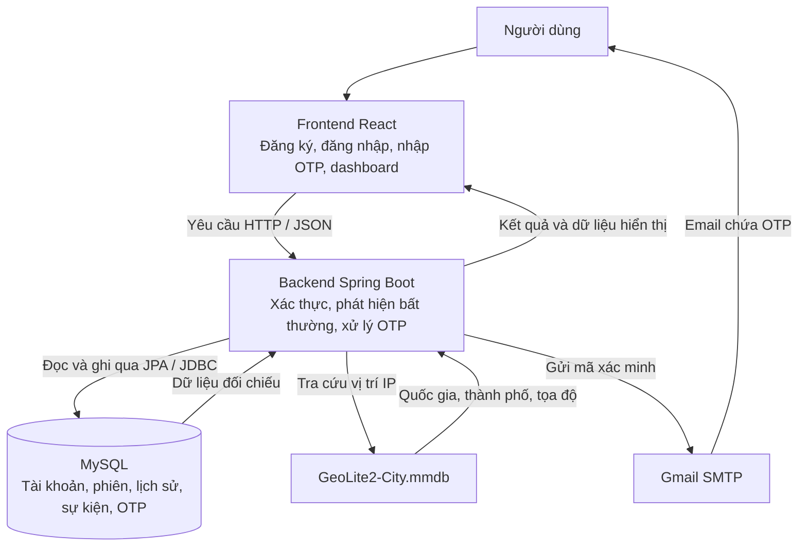

# Impossible Travel Detection

**Đề tài:** Xây dựng hệ thống phát hiện đăng nhập bất thường dựa trên khoảng cách địa lý và thời gian.

Hệ thống phân tích vị trí IP và thời gian giữa các lần đăng nhập để phát hiện hành vi di chuyển bất khả thi, đồng thời yêu cầu xác minh bổ sung qua email OTP trước khi cho phép truy cập.

## Chức năng chính

- Đăng ký tài khoản, xác minh email và bảo vệ mật khẩu bằng BCrypt.
- Tra cứu vị trí IP bằng GeoLite2-City, tính khoảng cách bằng công thức Haversine.
- Phát hiện đăng nhập đồng thời hoặc nối tiếp bất thường với ngưỡng vận tốc mặc định 900 km/h, áp dụng khi khoảng cách trên 50 km.
- Xác minh đăng nhập bất thường bằng OTP qua email: mã dùng một lần, hạn 5 phút, giới hạn nhập sai và gửi lại.
- Chưa ghi lịch sử bị chặn khi đang chờ OTP; tự ghi khi hết hạn mà chưa xác minh thành công.
- Quản lý phiên, đăng xuất và giám sát lịch sử, cảnh báo trên dashboard.
- Mô phỏng nguồn đăng nhập bằng IP có sẵn hoặc IP tùy chỉnh.

## Công nghệ

- **Backend:** Java 21, Spring Boot, Spring Security, Spring Data JPA, Spring Mail.
- **Frontend:** React, Vite, Axios, Lucide React.
- **Dữ liệu:** MySQL, MaxMind GeoLite2-City.
- **Kiểm thử:** JUnit 5, Mockito, MockMvc, H2.

## Cấu trúc hệ thống

Frontend gửi yêu cầu đến backend; backend đối chiếu vị trí và lịch sử trong cơ sở dữ liệu. Nếu đăng nhập bất thường, backend yêu cầu OTP qua email trước khi cấp phiên. Kết quả được trả về frontend và cập nhật trên dashboard.

## Các trang

- `/login`: đăng ký và đăng nhập demo.
- `/welcome`: lời chào sau khi đăng nhập thành công.
- `/admin/dashboard`: dashboard giám sát an ninh.

IP được truyền trực tiếp trong bản demo localhost; GeoLite2 cung cấp vị trí địa lý ước lượng để phục vụ phát hiện bất thường.
